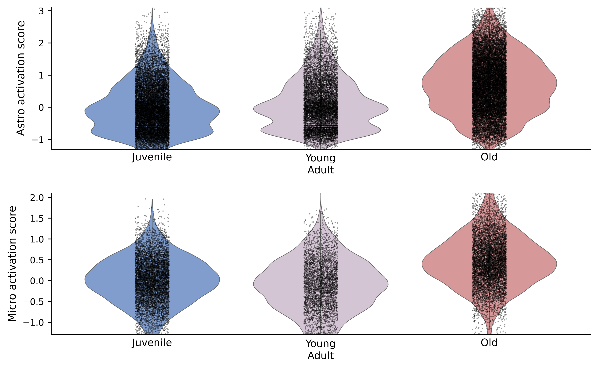
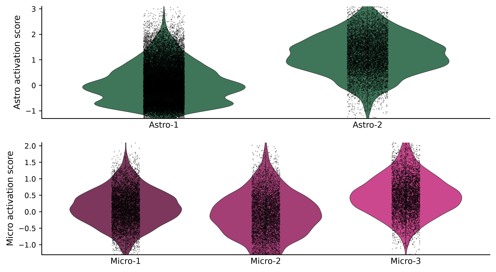
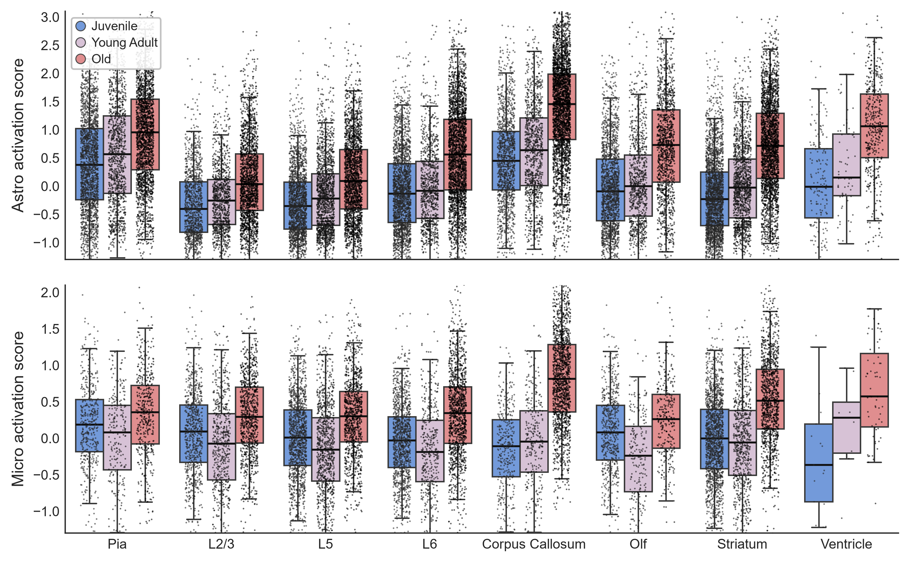

# Reproducing Figure 5A / 5B / 5D — Mouse Brain Aging

复现 **Allen et al., Cell (2022)**
*Molecular and spatial signatures of mouse brain aging at single-cell resolution*
(Dulac / Zhuang lab)

代码严格按作者官方仓库实现，未做简化：

> <https://github.com/ZhuangLab/SpatialBrainAgingCell22>
> notebook `notebooks/merfish_spatial_celltype_org.ipynb`（CELL 41–43）

---

## 复现结果

| 面板 | 内容 |
|---|---|
| **5A** | Astro / Micro 细胞 × 三年龄（Juvenile / Young Adult / Old）激活分数小提琴图 |
| **5B** | Astro-1/2、Micro-1/2/3 各亚群小提琴图 |
| **5D** | 8 个脑区 × 三年龄箱线图，叠加密集散点 |







**核心生物学结论**：星形胶质细胞激活随年龄单调升高；小胶质细胞在 24 周龄略低于幼年，
到 90 周龄才大幅跃升 —— "青年期短暂回落 + 老年激增" 的模式在两类胶质细胞中一致。

---

## 快速开始

```bash
pip install scanpy anndata seaborn matplotlib numpy pandas

# 方式一：命令行指定数据
python reproduce_figure5.py --input /path/to/data.h5ad

# 方式二：改脚本顶部 IN 常量后直接运行
python reproduce_figure5.py
```

输出默认写入 `figure5_out/`：

```
figure5_out/
├── 5A_activation_violin.png
├── 5B_cluster_violin.png
├── 5D_region_boxplot.png
├── astro_micro_scores.h5ad      # 含两个激活分数的全量数据
└── summary_tables.txt           # 全部统计汇总
```

### 输入数据

MERFISH 单细胞数据集，**378,918 细胞 × 374 基因**：

```
obs.age          : '4wk' / '24wk' / '90wk'（Juvenile / Young Adult / Old）
obs.clust_annot  : Astro-1, Astro-2, Micro-1, Micro-2, Micro-3 ...
obs.tissue       : 'pia mater' / 'cortical layer II/III' / ... （8 个脑区）
var.feature_name : 基因符号
adata.raw        : 原始计数矩阵
```

---

## 作者原始代码

**CELL 41 — 计算激活分数**
```python
sc.tl.score_genes(adata_annot,
    gene_list=['B2m','Trem2','Ccl2','Apoe','Axl','Itgax',
               'Cd9','C1qa','C1qc','Lyz2','Ctss'],
    score_name='activate_micro', use_raw=False)
sc.tl.score_genes(adata_annot,
    gene_list=['C4b','C3','Serpina3n','Cxcl10','Gfap','Vim','Il18','Hif3a'],
    score_name='activate_astro', use_raw=False)
```

**CELL 42 / 43 — 以 4wk 为基准归零**
```python
adata_micro = adata_annot[adata_annot.obs.cell_type=="Micro"]
adata_annot.obs.activate_micro -= np.mean(
    adata_micro[adata_micro.obs.age=='4wk'].obs.activate_micro)

adata_astro = adata_annot[adata_annot.obs.cell_type=="Astro"]
adata_annot.obs.activate_astro -= np.mean(
    adata_astro[adata_astro.obs.age=='4wk'].obs.activate_astro)
```

### 三个容易踩错的细节

1. **不做 Z-score。** 论文 STAR Methods 文字写了 "Z-scored gene expression values"，
   但作者代码里**没有** `sc.pp.scale`，直接 `use_raw=False` 在 log 数据上算分。
   **以代码为准。**
2. **不设 `random_state` / `ctrl_size`**，使用 scanpy 默认值（`ctrl_size=50`）。
3. **归零作用于 `obs` 全部细胞**（不置 NaN），基准是各自细胞类型中 4wk 批次的均值。

---

## 复现数值

校验（幼年组均值应精确为 0）：

```
activate_astro @ 4wk mean = 0.00000000
activate_micro @ 4wk mean = 0.00000000
```

**按年龄**

| | 4wk | 24wk | 90wk |
|---|---|---|---|
| activate_astro 均值 | 0.0000 | +0.1288 | **+0.7123** |
| activate_astro 中位数 | −0.0917 | +0.0046 | +0.6982 |
| activate_micro 均值 | 0.0000 | −0.1113 | **+0.4697** |
| activate_micro 中位数 | +0.0161 | −0.1028 | +0.4499 |

**按亚群（中位数）**

| | 4wk | 24wk | 90wk |
|---|---|---|---|
| Astro-1 | −0.2413 | −0.1276 | +0.3642 |
| Astro-2 | +0.7701 | +1.0758 | **+1.4494** |
| Micro-1 | +0.0405 | +0.0141 | +0.3122 |
| Micro-2 | −0.2193 | −0.2745 | +0.3010 |
| Micro-3 | +0.2612 | +0.1906 | **+0.6017** |

细胞数：Astro 37,480（12,831 / 8,352 / 16,297）；Micro 16,514（6,317 / 3,496 / 6,701）
分数范围：astro [−1.99, 4.13]、micro [−2.19, 2.94]

完整表格见 [`figures/summary_tables.txt`](figures/summary_tables.txt)。

---

## 绘图参数

| 位置 | 参数 |
|---|---|
| 5A/5B 小提琴 | `sns.violinplot(cut=0, bw_adjust=1)` |
| 5A/5B 散点 | `scatter(s=1.5, alpha=0.4, jitter=±0.1)` — 中央窄竖带 |
| 5D 散点 | `sns.stripplot(dodge=True, jitter=0.25, s=1.0, alpha=0.6, zorder=5)` |
| 纵轴 | astro `(−1.3, 3.1)`、micro `(−1.3, 2.1)`（下限留白，小提琴底端悬空） |
| 图例 | 左上角，竖排，无标题，彩色圆点 |

### 配色

采样自论文原图 PDF（400 dpi 裁剪 → 按颜色连通块定位各 violin → 取众数色），非目测：

| 用途 | 色值 |
|---|---|
| Juvenile | `#739ADA` 蓝 |
| Young Adult | `#D7C2D6` 淡紫 |
| Old | `#E08E8F` 鲑红 |
| Astro-1 / Astro-2 | `#367F5A` 深绿（同色） |
| Micro-1 / 2 / 3 | `#892B5D` → `#B42E77` → `#E23290` 品红渐变 |

---

## 实现中遇到的问题

### 1. `cell_type` 标签与作者不一致 → 全 NaN

作者代码用 `cell_type=="Micro"` / `"Astro"`，但本数据集 `obs.cell_type` 用的是全称：

```
astrocyte         37,480
microglial cell   16,514
```

直接照抄会取到空集导致全 NaN。解决：建立语义映射。
细胞数校验一致 —— `astrocyte` = Astro-1 + Astro-2，`microglial cell` = Micro-1/2/3。

### 2. `plt.violinplot()` 不支持 `cut`

`cut` 是 seaborn 的参数，matplotlib 原生没有。
若需严格裁剪 KDE 尾部，可改用 `scipy.stats.gaussian_kde` 手绘。
本复现使用 seaborn 的 `cut=0`。

### 3. seaborn `stripplot` 参数冲突

当前版本中：
- `stripplot(linewidths=)` 与内部传入的 `linewidth` 别名冲突 →
  `TypeError: Got both 'linewidth' and 'linewidths'`
- `stripplot(width=...)` 被透传到 `PathCollection.set()` →
  `AttributeError: unexpected keyword argument 'width'`

解决：用 `linewidth=0`；宽度靠与 boxplot 共用 dodge 几何自动对齐，不手动指定。

### 4. 5D 散点 jitter 不能为 0

实测论文原图（500 dpi 裁剪 + 逐列统计暗像素）：

| | 宽度 |
|---|---|
| 黑色点带 | **19–23 px** |
| 彩色箱体 | **11–13 px** |

点带比箱体**更宽**（约 1.7 倍）且极其密集。`jitter=0` 会让所有点重叠成 1 px 细线，
完全丢失"密密麻麻"的视觉效果。最终采用 `jitter=0.25, size=1.0, alpha=0.6`。

### 5. zorder 必须显式设定

`stripplot` 未传 zorder 时其 `PathCollection` 会拿到 `zorder=3`，与 `boxplot` 相同，
层级不可控。目标效果是**黑点压在箱体之上**，故显式设 `zorder=5`（箱体 3、中位线 4）。

---

## 文件说明

```
reproduce_figure5.py    # 唯一脚本，包含算分 + 绘图 + 统计输出
figures/                # 复现产物
data/                   # 数据存放目录（.h5ad 约 350 MB，不纳入版本控制）
```

---

## 引用

```bibtex
@article{allen2022molecular,
  title   = {Molecular and spatial signatures of mouse brain aging
             at single-cell resolution},
  author  = {Allen, William E. and Blosser, Timothy R. and Sullivan, Zuri A.
             and Dulac, Catherine and Zhuang, Xiaowei},
  journal = {Cell},
  year    = {2022},
  doi     = {10.1016/j.cell.2022.12.010}
}
```
